<div align="center">

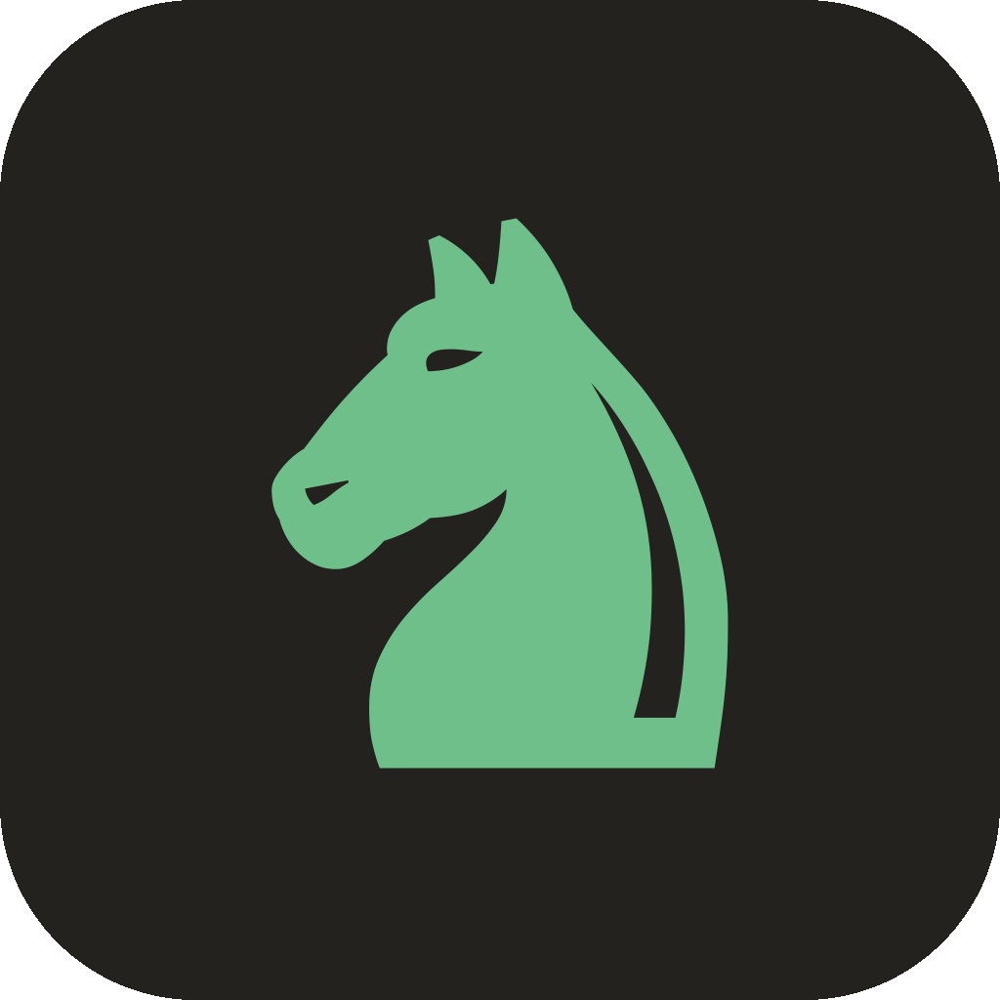

# Chess Coach

**A personal chess coach on your desktop.** Play human-like opponents, get every game reviewed,
drill your own mistakes until they stick, and ask an AI coach *why*. It answers on the board.


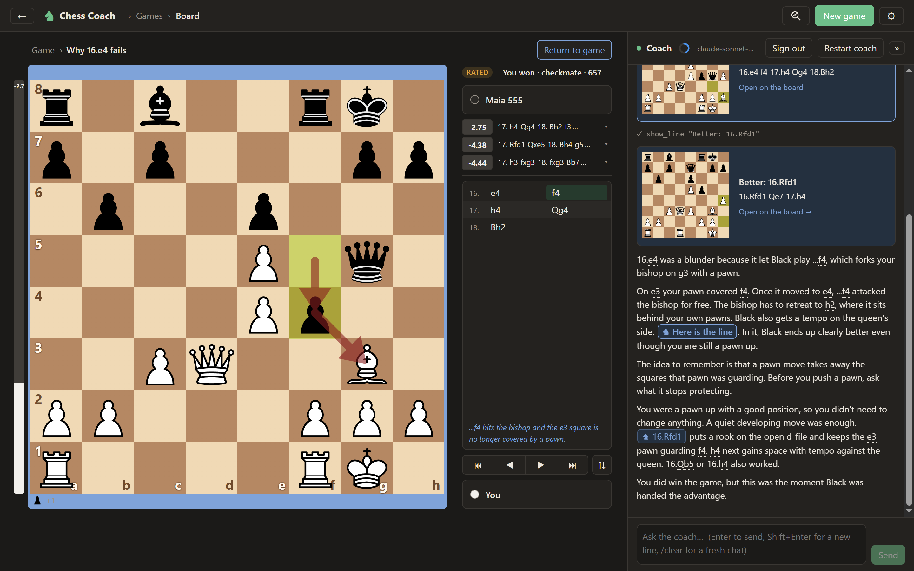

<sub><i>Ask "why was that a blunder?" and the coach answers with a line you can step through on the board.</i></sub>

</div>

---

## What makes it different

<table>
<tr>
<td width="50%" valign="top">
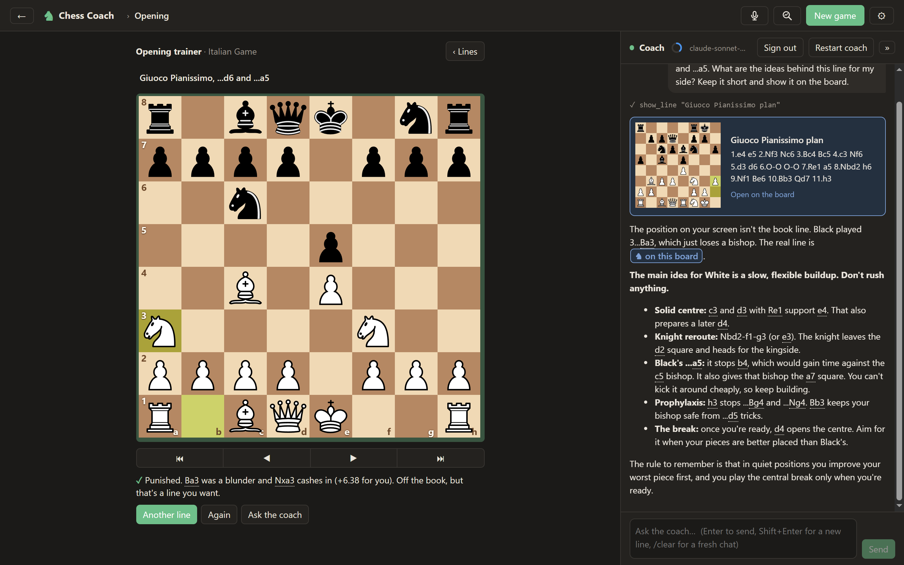

### 🗣️ A coach that draws on the board
Ask anything about your game. The coach answers with **scenarios**: lines it sets up with its
own arrows and circles at every step, linked right in its reply. Click one and it plays out on the
main board. It only reports what Stockfish actually found, so it doesn't invent tactics. It can also
**quiz you** on a position, and it remembers what you struggle with.
</td>
<td width="50%" valign="top">
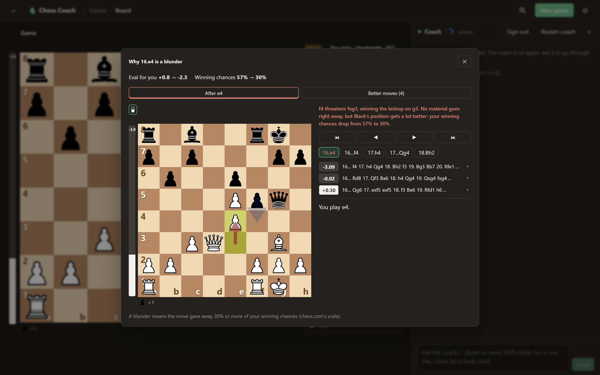

### 💥 Blunders explained, not just flagged
**"Why is it a blunder?"** tells you in plain English what your move allowed, with the refutation
as arrows you step through. Quiet mistakes get concrete reasons too: *"your pawn on e5 now blocks
your bishop on g7"*, not *"White's position improves"*.
</td>
</tr>
<tr>
<td width="50%" valign="top">
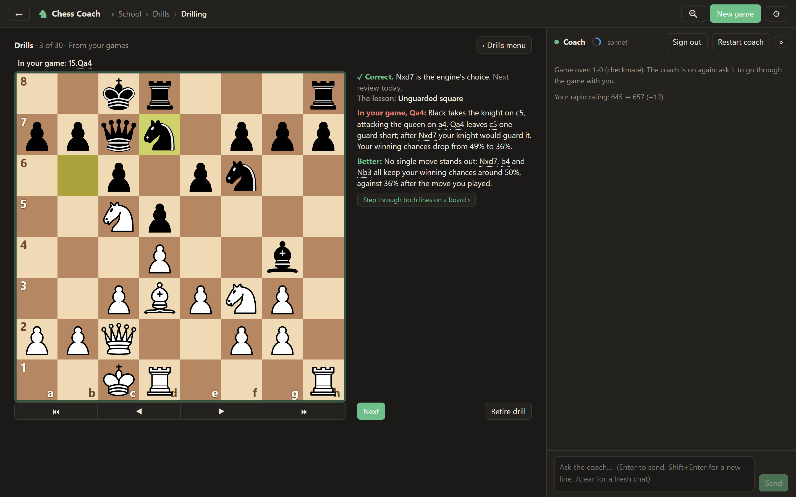

### 🔁 Your mistakes come back as drills
Every real mistake you make is **captured automatically** as a drill, with its lesson worked out
on the spot: what you played, what was best, and the theme behind it (fork, trapped piece,
unguarded square, ...). Drills return on a spaced-repetition schedule until you get them right.
</td>
<td width="50%" valign="top">
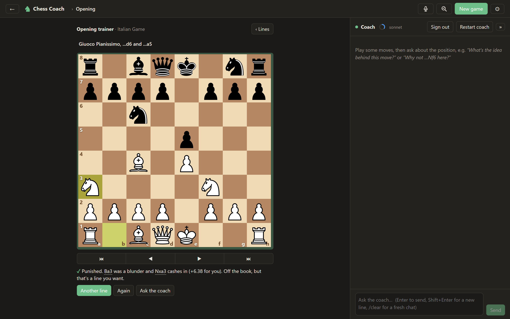

### 📖 An opening trainer that knows the ideas
Learn a repertoire against a book opponent that plays real-world move frequencies. Harmless
transpositions count, engine-equal moves get `≈` instead of a red X, and **"why not?"** has the coach
explain the theory. Now and then the opponent **blunders on purpose** to check you're looking at
the board. Every line ends with **the plan**, drawn on the board.
</td>
</tr>
<tr>
<td width="50%" valign="top">
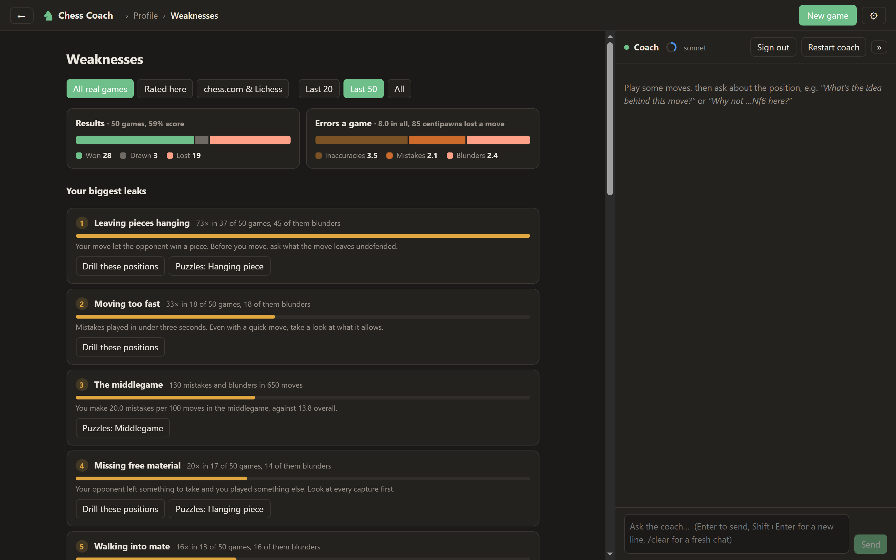

### 🎯 It finds your leaks
Import your **chess.com and Lichess** games and the Profile ranks what's actually costing you
points: hanging pieces, moving too fast, missed free material. Each leak links straight to drills
of those exact positions.
</td>
<td width="50%" valign="top">
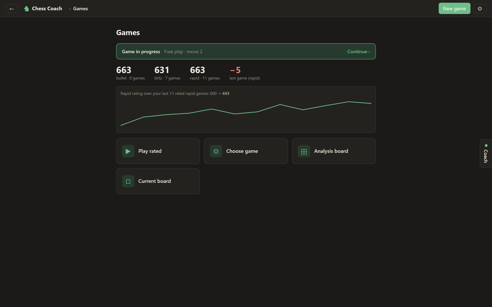

### 🧠 Opponents that play like people
Rated games pair you with **Maia**, a neural network trained on human games, near your rating, so
it makes human mistakes. Separate bullet, blitz and rapid ratings, all on the **chess.com scale**.
</td>
</tr>
<tr>
<td width="50%" valign="top">
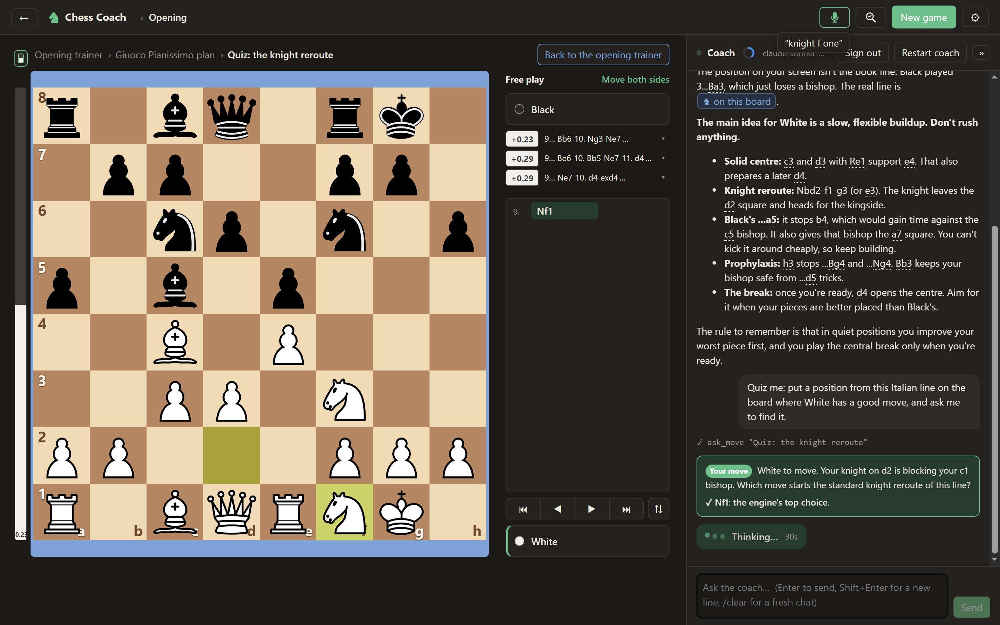

### 🎙️ It quizzes you, and you can just say the answer
The coach puts a position on the board and waits for your move, then grades it against the engine.
A miss becomes a drill. Here the answer was spoken: *"knight f one"*, recognized **offline** on your
own machine.
</td>
<td width="50%" valign="top">
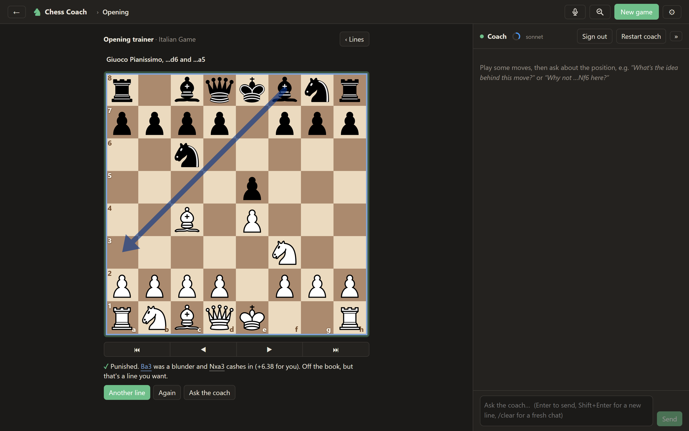

### 👆 Hover any move to see it
Every square and move in any text (the coach's, a trainer's, a lesson's) is live. Hover it and the
board shows it, even from an earlier position: here *Ba3* from the message below the board.
</td>
</tr>
</table>

**And everywhere:**

- ✏️ **Draw on every board.** Right-click drag on desktop, two fingers on a phone.
- ⌨️ **Type your moves** (`e4`, `Nf3`, `O-O`, then Enter) or say them.
- 🔍 **An analysis board on top of anything**, with what-if branches for both sides.
- 📱 **Your phone becomes a client.** Puzzles and drills keep working offline.

---

## Contents

- [Features](#features)
  - [An AI coach that teaches on the board](#an-ai-coach-that-teaches-on-the-board)
  - [Play opponents that play like people](#play-opponents-that-play-like-people)
  - [Every game reviewed](#every-game-reviewed)
  - [Find your weaknesses](#find-your-weaknesses)
  - [Drills built from your own mistakes](#drills-built-from-your-own-mistakes)
  - [Puzzles](#puzzles)
  - [Opening and endgame training](#opening-and-endgame-training)
  - [Analysis board, anywhere](#analysis-board-anywhere)
  - [Play from your phone](#play-from-your-phone)
- [Getting started](#getting-started)
- [Development](#development)
- [Credits](#credits)

---

## Features

### An AI coach that teaches on the board

The chat column holds a coach powered by Claude. It doesn't send you move lists: it builds
scenarios with arrows and circles and links them in its answer, and one click opens the scenario on
the main board. It's grounded in what the engine actually computed, so it can't make up tactics.
Every square and move it mentions highlights on the board when you hover over it.

It can also put a position on a side board and **ask for your move**. It's graded against the
engine, and a miss becomes a drill. It keeps notes on what you keep getting wrong, so later
advice builds on earlier games.

### Play opponents that play like people

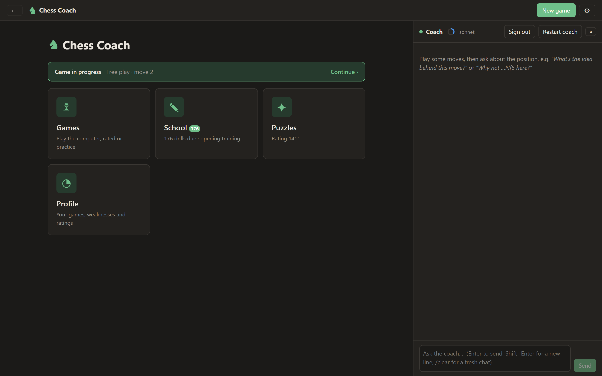

- **Play rated:** pick a clock and get paired with a [Maia](https://www.maiachess.com/) opponent
  near your rating. Maia is trained on human games, so it makes human mistakes rather than playing
  like an engine.
- **Separate bullet, blitz and rapid ratings**, all on the **chess.com scale**, so the numbers
  mean what you're used to.
- **Practice games** against Maia or Stockfish at any strength, with takebacks. After a clear
  mistake, a quick local check offers you a takeback, the better move, or the coach.
- **Type moves** on the keyboard (`e4`, `Nf3`, `O-O`) or **say them** with the top bar's mic. Speech
  recognition runs offline on your device ([Vosk](https://alphacephei.com/vosk/)), and in rated games
  it asks you to confirm each move first.
- Draw arrows on **any** board with a right-click drag.

### Every game reviewed

<table>
<tr>
<td width="50%">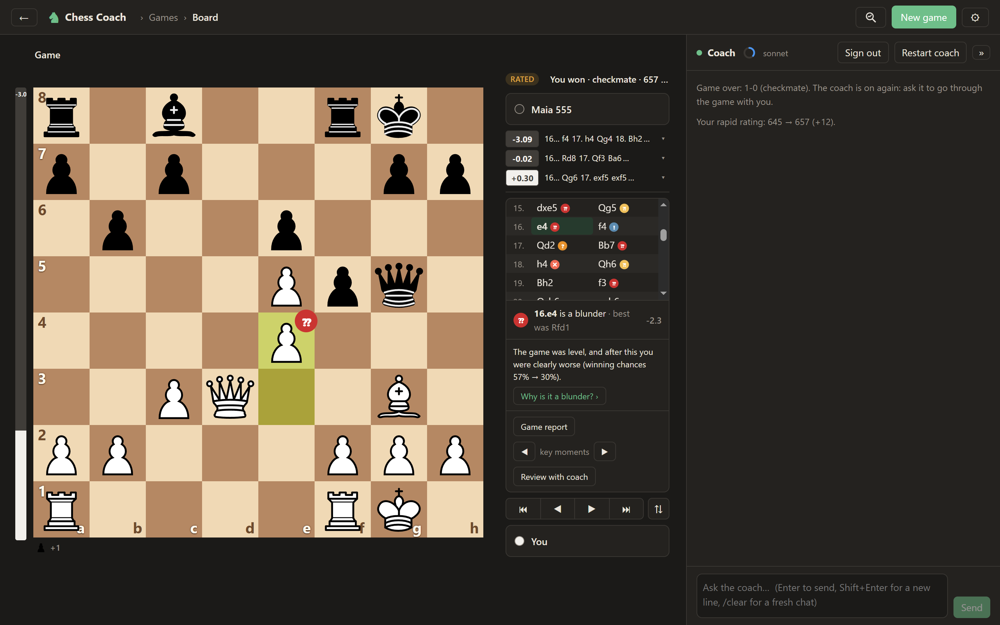</td>
<td width="50%">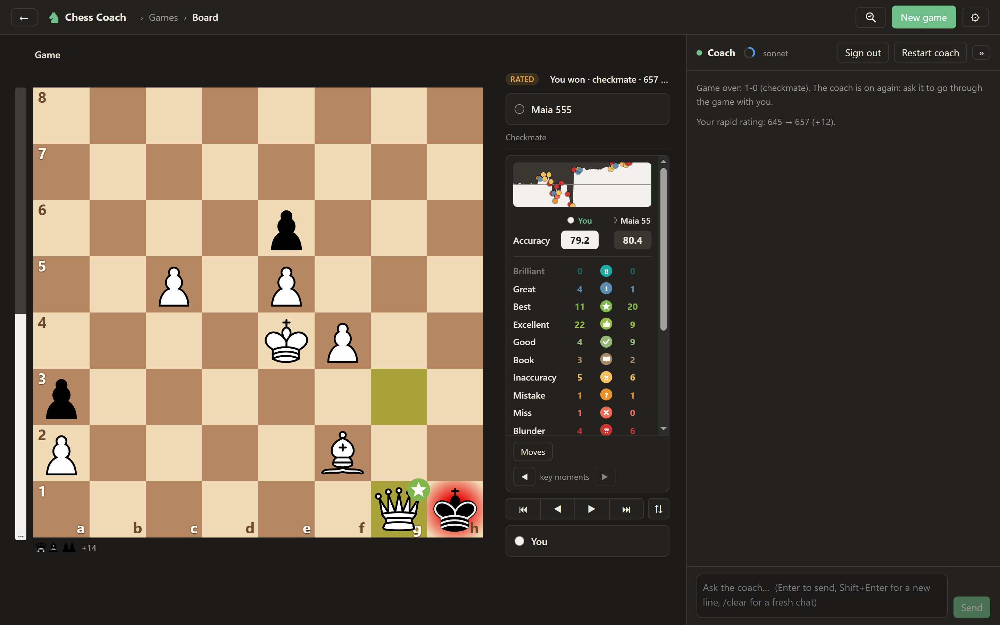</td>
</tr>
</table>

Each game ends with a full report: accuracy, an eval graph, and every move classified from
*brilliant* to *blunder*. Jump between key moments, try your own what-if moves from any position,
or hand the game to the coach for a guided review.

**"Why is it a blunder?"** gives a plain-English explanation of what the move allowed, with the
refutation as arrows you can step through and the better moves next to it.

### Find your weaknesses

The Profile looks across your **real games** (rated games here plus games **imported from chess.com
and Lichess**) and ranks your biggest leaks: hanging pieces, moving too fast, missed free
material, walking into mate, weak phases of the game. Each leak links straight to drills of those
exact positions, or to puzzles on that theme. Rating history tracks everything over time.

### Drills built from your own mistakes

Positions you got wrong come back on a **spaced-repetition** schedule until they stick. Every drill
is a lesson worked out when the mistake was made: the move you played against the best one,
searched deeply, with the concrete theme behind it ("unguarded square", "fork", "trapped piece", ...).
Missed puzzles and your opening repertoire feed in too.

### Puzzles

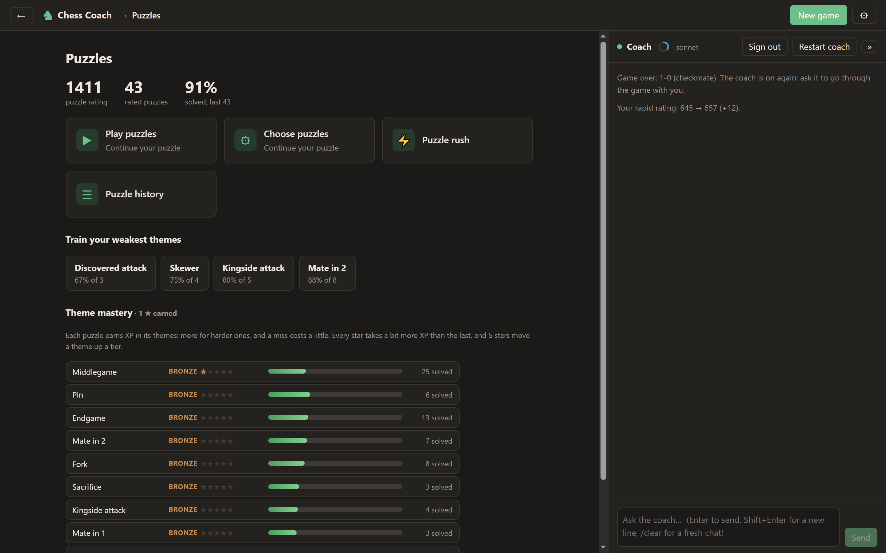

Millions of rated puzzles from the [Lichess puzzle database](https://database.lichess.org/#puzzles)
(downloaded once, on first use). There's a puzzle rating, **Puzzle Rush**, training on your weakest themes, and
**theme mastery** with stars and tiers that you earn per tactic.

### Opening and endgame training

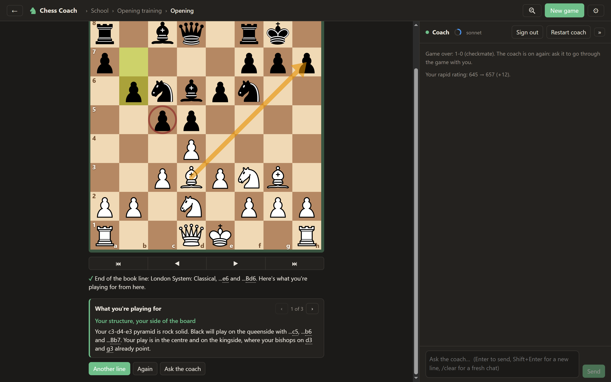

- **Opening trainer:** build a repertoire (London, Italian, Queen's Gambit, and defences as Black)
  and play it against the book. The opponent picks replies weighted by how often they're played.
  Transpositions that cost nothing are accepted, and engine-equal alternatives are marked `≈`
  instead of wrong. Ask **"why not?"** after leaving the line and the coach explains the theory.
  Sometimes the opponent leaves the book with a real blunder, and you have to punish it. At the end
  of every line you get **the plan**: what you're playing for, drawn on the board.
- **Endgame trainer:** convert the standard endings against Stockfish.
- **Guess the move:** play through master games and predict each move.

### Analysis board, anywhere

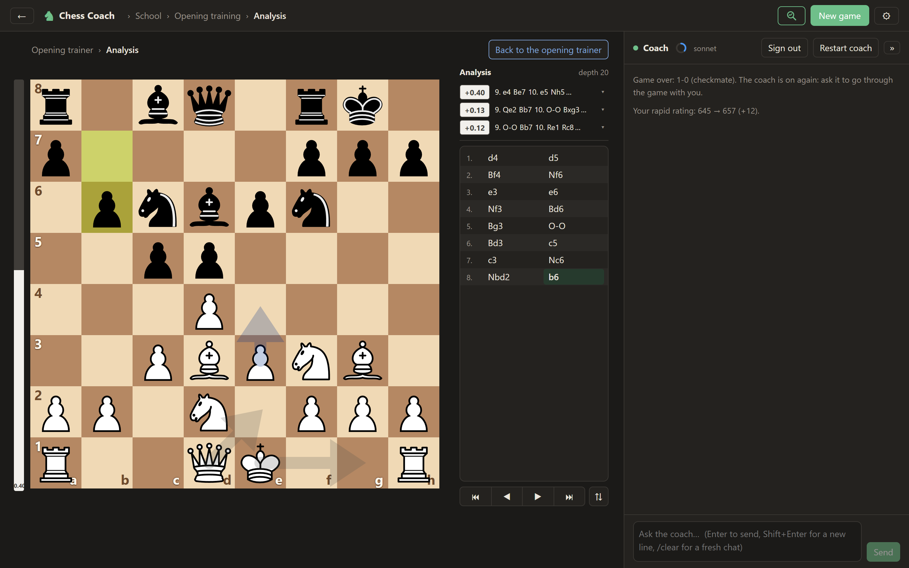

The magnifier opens an analysis board on top of whatever you're looking at, at the same position,
with an eval bar, Stockfish's top three lines and what-if branches. It's off during rated games,
and on puzzles or drills until you've answered.

### Play from your phone

<table>
<tr>
<td width="34%">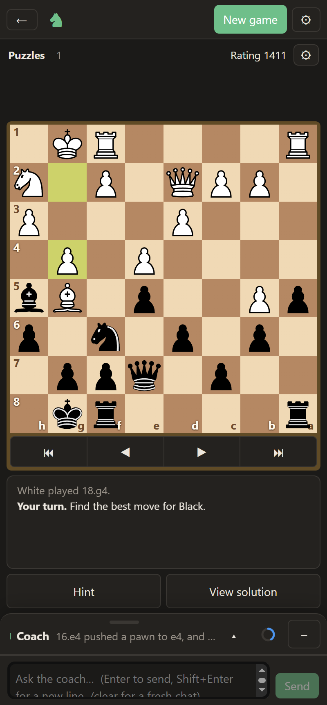</td>
<td>

The desktop app serves the same app to your phone. Pair it with a code, add it to your home screen,
and play, solve puzzles and drill from the couch. Engines run on the phone itself, and **puzzles and
drills keep working offline**: your answers sync when the computer is back.

With [Tailscale](https://tailscale.com/) it works from anywhere, privately, over HTTPS, with one
button in Settings. See [docs/phone.md](docs/phone.md).

</td>
</tr>
</table>

---

## Getting started

Setup is short. You need:

| Requirement | Why |
| --- | --- |
| [Node.js](https://nodejs.org/) 20+ | Frontend and setup scripts |
| [Rust](https://rustup.rs/) (stable) | The Tauri desktop shell |
| [Claude Code](https://claude.com/claude-code), signed in | Powers the coach and uses your existing Claude login, so there are no API keys to manage |

On Windows, Tauri also needs WebView2 (already installed on Windows 10/11) and the
[MSVC build tools](https://tauri.app/start/prerequisites/).

Then:

```bash
git clone https://github.com/aleto44/chesscoach.git
```

```bash
cd chesscoach
```

```bash
npm install
```

```bash
npm run tauri dev
```

That's it. `npm install` sets everything up for you: it patches the board library, copies
**Stockfish** into place and downloads the **Maia** model (~46 MB). The Lichess puzzle database
downloads inside the app the first time you open Puzzles.

> **Windows shortcut:** `scripts/start-dev.ps1` launches the app, reinstalls packages when they
> change and restarts the app if it crashes. Point a desktop shortcut at it.

To build an installer instead:

```bash
npm run tauri build
```

---

## Development

| | |
| --- | --- |
| `src/` | React + TypeScript frontend (boards, trainers, review, chat) |
| `src-tauri/` | Rust backend: SQLite storage, coach process, puzzle DB, imports, phone server |
| `src/engine/` | Stockfish and Maia, running in the browser (WASM / ONNX) |
| `src/rating.ts` | Rating scale conversions (everything shown is on the chess.com scale) |

```bash
npx tsc --noEmit
```

```bash
npm run dev
```

The first command type-checks. The second runs the web UI alone on port 1420. Opening lines are
checked with `node scripts/check-book.mjs`. Contributor and AI-assistant conventions are in
[.github/copilot-instructions.md](.github/copilot-instructions.md).

---

## Credits

- [Stockfish](https://stockfishchess.org/) (GPL-3.0): engine analysis
- [Maia](https://github.com/CSSLab/maia3) (AGPL-3.0), by the CSSLab at the University of Toronto: human-like opponents
- [Lichess open database](https://database.lichess.org/) (CC0): puzzles
- [Vosk](https://alphacephei.com/vosk/) (Apache-2.0): offline speech recognition for voice moves
- [Chessground](https://github.com/lichess-org/chessground) and [chess.js](https://github.com/jhlywa/chess.js): the board and the rules
- [Claude](https://claude.com/): the coach
